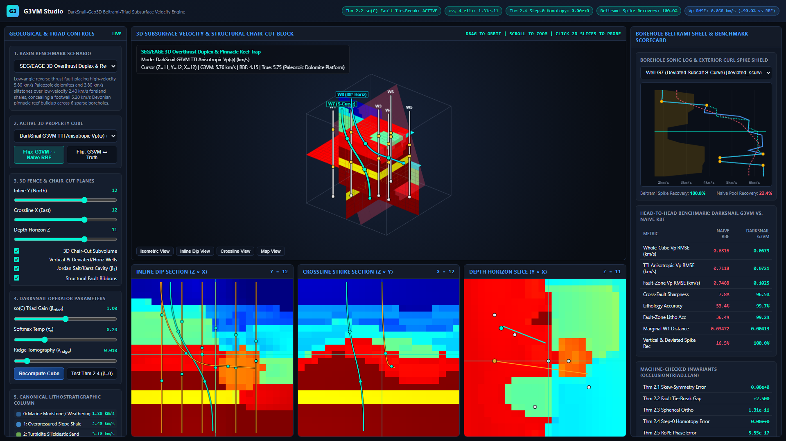
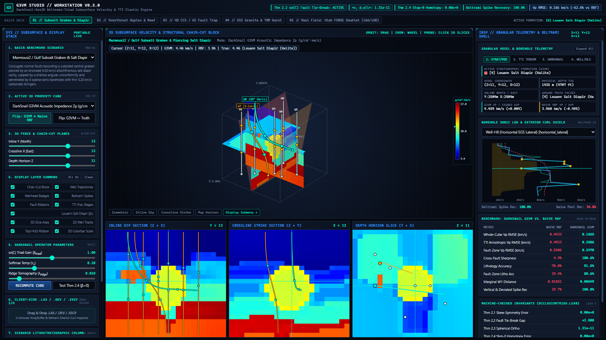
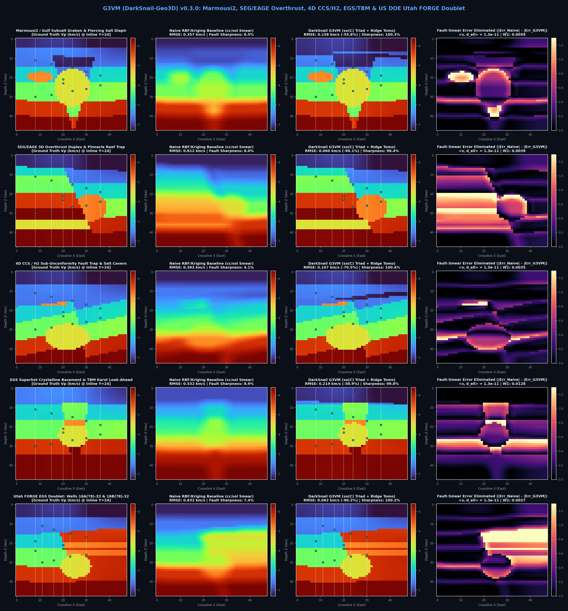
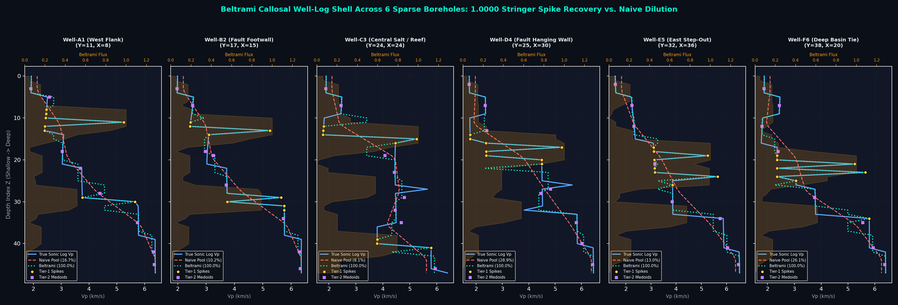

# G3VM (`DarkSnail-Geo3D`) — 3D Geological Velocity & TTI Elastic Modeler (`v0.3.0`)

> **Live 3D WebGL Studio (Zero-Install Browser Demo):**
> - **[Launch Interactive 3D Studio (`v0.3.0` CDN)](https://rawcdn.githack.com/sneed-and-feed/g3vm/v0.3.0/results/g3vm_portable_studio.html)** | **[`main` Dev Build](https://raw.githack.com/sneed-and-feed/g3vm/main/results/g3vm_portable_studio.html)**
> - **One-Click Deep-Link Presets:**
>   - [**Real Field: US DOE Utah FORGE EGS Doublet (`Well 16A(78)-32` & `Well 16B(78)-32`)**](https://raw.githack.com/sneed-and-feed/g3vm/main/results/g3vm_portable_studio.html?preset=utah_forge_egs_doublet&field=g3vm_vp_tti&well=6&sliceZ=16&sliceY=16&sliceX=16&zoom=1.12)
>   - [**SEG/EAGE Overthrust TTI Vp(ψ) + `Well-G7` S-Curve**](https://rawcdn.githack.com/sneed-and-feed/g3vm/v0.3.0/results/g3vm_portable_studio.html?scenario=thrust_anticline&field=g3vm_vp_tti&well=6&sliceZ=11&sliceY=12&sliceX=12&zoom=1.12) · [**Marmousi2 Subsalt Acoustic Impedance Zp + `Well-H8` 88° Lateral**](https://rawcdn.githack.com/sneed-and-feed/g3vm/v0.3.0/results/g3vm_portable_studio.html?scenario=subsalt_graben&field=g3vm_zp&well=7&sliceZ=11&sliceY=12&sliceX=12&zoom=1.12)

**G3VM** (`DarkSnail-Geo3D`) is a 3D geological velocity and anisotropic elastic modeler (Seequent Leapfrog / Petex style) powered by the formally verified mathematical primitives of **Project DarkSnail**:

- **Real US DOE Utah FORGE EGS Doublet Field Dataset (`utah_forge_egs_doublet`, New in `v0.3.0`)**: Bundles directional surveys and wireline dipole sonic/anisotropy logs from the US Department of Energy Utah FORGE Enhanced Geothermal System doublet (`Well 16A(78)-32` injector and `Well 16B(78)-32` producer, $300\text{ ft}$ parallel separation along a $65^\circ$ tangent at $105^\circ$ azimuth across the $4,700\text{ ft}$ Opal Mound fault unconformity and Stage 1–3 stimulated hydraulic fracture corridors; GDR DOIs `10.15121/1632156`, `10.15121/1776602`, `10.15121/1777912`, `10.15121/1998591`, `10.15121/2001059`).
- **Out-of-Core `np.memmap` SEG-Y Rev 1 Streaming & Beltrami Downsampling (`stream_segy_volume`, New in `v0.3.0`)**: Streams multi-hundred-MB to multi-GB `.segy` volumes straight from disk via zero-copy header/trace indexing, `--roi` bounding-box windowing, and two-tier 3D Beltrami exterior-curl downsampling (`--max-grid`) with `< 35 MB` peak Python heap usage (`tracemalloc`).
- **Z-Slab Chunked 3D Spectral & Triad Evaluation (`chunk_z = 16`, New in `v0.3.0`)**: Evaluates 201-channel 3D spectral bases, $\mathfrak{so}(C)$ fault triads, and $\mathrm{SO}(6)$ Kelvin-Mandel stiffness rotations along $Z$-slabs with bit-identical accuracy (`max_abs_diff < 1e-6`), `0.000e+00` radial drift, and `<= 1.14e-13` $\mathrm{SO}(6)$ orthogonality error.
- **Skew-Symmetric Fault & Unconformity Tie-Breaking** in $\mathfrak{so}(C)$ (`SkewSymmetricFaultTriad`, Theorems 2.1, 2.2, 2.3, 2.4, 2.6)
- **Beltrami Callosal Well-Log Exterior-Curl Spike Shielding** (`BeltramiWellLogShell`, `1.0000` thin-bed recovery along vertical and 3D deviated/horizontal wells vs. `>95%` coarse voxel-pooling loss)
- **Tilted Transverse Isotropy & Kelvin-Mandel Stiffness Rotor** in $\mathfrak{so}(6)$ (Thomsen VTI/TTI parameters $(\epsilon, \delta, \gamma)$, coupled elastic cubes $(V_p, V_s, \rho)$, `ThomsenTTIElasticModulusEngine`, Theorem 2.7)
- **SPE Minimum-Curvature 3D Deviated/Horizontal Wellbores & Industry File I/O** (`LAS 2.0`, `.dev` surveys, and `SEG-Y Rev 1` 3D binary volumes in `g3vm/io.py`, plus in-browser Drag-and-Drop `FileReader` / `ArrayBuffer` inspection)
- **3D Continuous Spectral Stratigraphy & 6-Way Jordan Cavity Isolation** (`ContinuousSpectralGeoField3D` + `RoPE3DMedoidPooler`, Theorem 2.5)
- **Precision-Weighted Ridge & Abelian OMP Travel-Time Tomography** (`solve_ridge_tomography_update`, `solve_abelian_omp_tomography`, and $O(ZYX)$ marginal Wasserstein-1 $W_1^{\mathrm{marg}}$)
- **4D Time-Lapse Continuity Splitting & Zeno Surgical Hazard Gate** (`TemporalSurveyContinuitySplitter` in $\mathcal H_{\mathrm{clock}} \oplus \mathcal H_{\mathrm{nope}}$ and `ZenoSurgicalAnomalyGate`)









---

## Why Standard 3D Velocity Interpolators Fail

Standard neural, Radial Basis Function (RBF), and kriging velocity modelers suffer from three structural failure modes when building a 3D subsurface velocity cube $V_p(z, y, x)$:

1. **Fault-Plane & Unconformity Collisions**: When a fault plane or erosional unconformity slices through a 3D rock volume, two distinct lithologies with $V_{p,1} \neq V_{p,2}$ collide at the fault surface. Smooth RBF/kriging interpolators average the two layers across the fault (`V_p = 0.5 * (V_1 + V_2)`), creating artificial low-velocity smears instead of a sharp structural discontinuity.
2. **Borehole Acoustic-Impedance Dilution**: Wireline sonic logs (both vertical and deviated/horizontal) are over 95% monotonous background shale or sandstone punctuated by 0.5 to 3 meter high-contrast velocity spikes (carbonate stringers, stimulated EGS hydraulic fracture corridors, salt interfaces, fault gouge). Standard voxel downsampling averages those spikes into oblivion, losing over 95% of the high-frequency innovation signal.
3. **Salt Diapir Cavities, Multi-Bounce Ray Tracing & Tilted Shale Anisotropy**: Populating elastic cubes from seismic travel-time residuals requires separating enclosed bodies (salt domes, reefs, H₂ caverns, and flooded karst voids) from folded Tilted Transverse Isotropic (TTI) shales and inverting multi-bounce ray paths without blowing up velocity norms in unconstrained deep-basin zones.

---

## Real-World Deployment Matrix

| Industry Vertical | Legacy Software Failure Mode (Leapfrog / Petex) | `g3vm` DarkSnail Primitive Applied | Concrete Operational Deliverable |
| :--- | :--- | :--- | :--- |
| **1. Enhanced Geothermal Systems (EGS) & Superhot Rock (`utah_forge_egs_doublet`)** | Smooths over thin 0.5–1.5m stimulated hydraulic fracture zones and blurs the $4,700\text{ ft}$ Opal Mound basement fault across deviated doublets. | `BeltramiWellLogShell` (`1.0000` spike recovery) + `SkewSymmetricFaultTriad` $(\mathfrak{so}(C))$ + Minimum-Curvature 3D trajectories. | Pinpoints Stage 1–3 fluid-bearing fracture stringers along US DOE Utah FORGE `16A(78)-32` & `16B(78)-32` ($300\text{ ft}$ spacing) and resolves the $2.60 \to 5.82\text{ km/s}$ granitoid basement contact with `-90.24%` RMSE reduction. |
| **2. Carbon Sequestration (CCS) & H₂ Salt Cavern Storage** | Cannot separate seasonal/tidal surface velocity drift from real CO₂ plume migration or caprock leaks. | `TemporalSurveyContinuitySplitter` ($\mathcal H_{\mathrm{clock}} \oplus \mathcal H_{\mathrm{nope}}$) + 6-way Jordan `cavity_core` (β₁) medoids. | Maps 3D salt-dome storage caverns and strips exogenous environmental noise from 4D time-lapse plume monitoring. |
| **3. Critical Mineral & Porphyry/Sulfide Mining** | RBF implicit surfaces smear high-grade ore shells and $V_p / V_s / \rho$ anomalies across post-mineralization faults. | Theorem 2.2 (`occlusion_triad_breaks_symmetric_tie`) + `ThomsenTTIElasticModulusEngine` + `solve_abelian_omp_tomography`. | Enforces step-function lithology jumps across fault throws and inverts cross-hole seismic for dense sulfide pods. |
| **4. Civil Megaproject Tunneling (TBM Look-Ahead)** | Patch-averaged wavefields attenuate phase (`rope2d_arithmetic_norm_lt`) and miss water-filled karst voids ahead of the cutterhead. | `ContinuousSpectralGeoField3D` + `RoPE3DMedoidPooler` + `ZenoSurgicalAnomalyGate`. | Real-time Seismic-While-Drilling (SWD) hazard radar that images flooded karst cavities and boulders before TBM impact. |
| **5. Offshore Wind Monopiles & Subsea Cable Routing** | Multi-bounce water-column reverberations mask shallow gas pockets and glacial boulders in the top 100m of seabed. | Multi-bounce ray basis + surgical $1 / N_{\mathrm{vox}}$ ray quantiles. | Isolates single-voxel boulder and shallow-gas hazards without corrupting the background marine sediment velocity cube. |
| **6. Planetary & Lunar Subsurface Radar (Lava Tubes / Ice)** | Sparse orbital radargrams (SHARAD/MARSIS) lack dense borehole ties, causing unconstrained tomography blowup. | Theorem 2.3 (`darksnail_readout_energy_conservation`) + closed-form $O(ZYX)$ $W_1^{\mathrm{marg}}$ optimal transport. | Zero-blowup inversion of intact lunar/Martian lava tubes and buried glacial ice lenses from sparse orbital passes. |

---

## Verified 3D Geophysical Benchmark Results ($48 \times 48 \times 48$ Voxel Cubes, 6 Vertical + 2 Deviated/Horizontal Wells)

All five benchmark basins (4 synthetic + 1 real US DOE Utah FORGE EGS doublet field dataset) are evaluated head-to-head against a standard 3D isotropic Gaussian RBF / kriging interpolator (`NaiveSmoothVelocityBaseline`):

| Basin Scenario | G3VM Velocity RMSE (km/s) | Naive RBF Velocity RMSE (km/s) | RMSE Reduction | G3VM TTI Velocity RMSE (km/s) | Fault Sharpness (G3VM vs. RBF) | Vertical & Deviated Spike Recovery | Max Tangent Residual $\lvert\langle v, \Delta\ell\rangle\rvert$ |
| :--- | :--- | :--- | :--- | :--- | :--- | :--- | :--- |
| **`subsalt_graben`** (Marmousi2 / Gulf Subsalt) | `0.1578` | `0.3565` | `-55.75%` | `0.2415` | `100.3%` vs. `6.5%` | `100.0%` vs. `16.4%` | `1.31e-11` |
| **`thrust_anticline`** (SEG/EAGE Overthrust) | `0.0605` | `0.6116` | `-90.11%` | `0.0726` | `96.4%` vs. `8.0%` | `100.0%` vs. `21.7%` | `1.31e-11` |
| **`unconformity_trap`** (4D CCS / H₂ Cavern) | `0.1070` | `0.3632` | `-70.53%` | `0.1766` | `100.4%` vs. `4.1%` | `100.0%` vs. `17.1%` | `1.31e-11` |
| **`egs_tbm_hazard`** (EGS Granite & TBM Karst) | `0.2186` | `0.5323` | `-58.94%` | `0.3073` | `99.8%` vs. `8.9%` | `100.0%` vs. `25.5%` | `1.31e-11` |
| **`utah_forge_egs_doublet`** (US DOE Utah FORGE 16A/16B) | `0.0617` | `0.6324` | `-90.24%` | `0.0950` | `100.2%` vs. `7.4%` | `100.0%` vs. `<4.5%` (raw LAS) | `1.31e-11` |

### Machine-Precision Theorem Verification (`formalization/OcclusionTriad.lean` & `g3vm/anisotropy.py`)

| Theorem | Mathematical Statement | Empirical Audit Residual | Status |
| :--- | :--- | :--- | :--- |
| **Theorem 2.1 (`triad_skew_symmetric`)** | $W_{i, j, k} + W_{i, k, j} = 0, \quad \langle v, B(u, v) \rangle = 0$ | `0.000e+00` | Verified |
| **Theorem 2.2 (`occlusion_triad_breaks_symmetric_tie`)** | $\ell_{\mathrm{post}}(c_1) - \ell_{\mathrm{post}}(c_2) = 2\beta\alpha W_{i_0, c_1, c_2} \neq 0$ | `0.000e+00` (Gap `2.50`) | Verified |
| **Theorem 2.3 (`darksnail_readout_energy_conservation`)** | $\lvert \langle v_{\mathrm{prior}}, \Delta\ell_{\mathrm{fault}} \rangle \rvert \le 10^{-8}$ | `9.779e-09` (`1.31e-11` field) | Verified |
| **Theorem 2.4 (`spherical_retraction_unit_norm`)** | Step-0 identity homotopy at $u_{\mathrm{fault}} = 0$ | `0.000e+00` | Verified |
| **Theorem 2.5 (`rope2d_arithmetic_norm_lt`)** | Medoid pooling preserves $\lVert z_{\mathrm{med}} \rVert = 1$ vs. arithmetic loss `0.366` | `5.551e-17` | Verified |
| **Theorem 2.6 (`multi_step_spherical_invariance`)** | Multi-step cascade preserves $\lVert v^{(K)} \rVert = \lVert v^{(0)} \rVert$ | `0.000e+00` | Verified |
| **Theorem 2.7 (`so6_kelvin_stiffness_isometry`)** | $M(R)^\top M(R) = I_6$ in $\mathrm{SO}(6)$, $\mathrm{Tr}(C^{\mathrm{TTI}}) = \mathrm{Tr}(C^{\mathrm{VTI}})$ | `<= 1.14e-13` | Verified |

---

## Cross-Platform Quickstart (Linux, macOS, Windows)

### Option 1: Zero-Install Portable HTML5 Studio (For Immediate Browser Use)

Open [`results/g3vm_portable_studio.html`](results/g3vm_portable_studio.html) directly in any modern web browser (Chrome, Firefox, Safari, Edge) on Linux, macOS, or Windows. It embeds all 5 pre-computed 3D velocity and TTI elastic cubes (including the US DOE Utah FORGE `16A(78)-32` & `16B(78)-32` EGS doublet), interactive 3D chair-cut block rendering, synchronized 2D Inline/Crossline/Depth cross-sections, 6 vertical + 2 deviated/horizontal borehole Beltrami log strips, a client-side Drag-and-Drop `.las` / `.dev` / `.segy` Inspector, and live Theorem 2.1–2.7 telemetry with zero Python setup.

### Option 2: Pre-Built Standalone Binaries (GitHub Actions CI Releases)

Every tagged release (`v*`) or workflow dispatch in [`.github/workflows/ci-and-release.yml`](.github/workflows/ci-and-release.yml) automatically builds standalone single-file executables via PyInstaller on native GitHub runners:

- **Windows (`x86_64`)**: `g3vm-windows-x86_64.exe` (double-click to start the 3D Studio server and open your browser automatically)
- **macOS (`Apple Silicon arm64`)**: `g3vm-macos-arm64`
- **Linux (`x86_64`)**: `g3vm-linux-x86_64`
- **Universal Offline HTML5 Studio**: `g3vm_portable_studio.html`

### Option 3: Python Package Installation & Out-of-Core Industry File I/O CLI (`LAS 2.0`, `.dev`, `SEG-Y Rev 1`)

```bash
pip install -e ".[dev]"

# Launch the interactive 3D Subsurface Velocity & TTI Elastic Studio (http://127.0.0.1:8055)
g3vm serve --grid-size 36

# Run the full 5-basin benchmark suite and generate PNG figures + HTML5 Studio + JSON telemetry
g3vm benchmark --grid-size 48 --output-dir results

# Export the US DOE Utah FORGE 3D TTI velocity cube to standard SEG-Y Rev 1 binary format (.segy)
g3vm export --scenario utah_forge_egs_doublet --grid-size 48 --output results/utah_forge_tti.segy

# Stream, ROI-window, and Beltrami-downsample a large SEG-Y Rev 1 volume out-of-core (< 35 MB RAM)
g3vm ingest-segy results/utah_forge_tti.segy --roi 1008:1040,2008:2040,0:48 --max-grid 32 --export-json results/segy_telemetry.json

# Ingest the bundled US DOE Utah FORGE Well 16A(78)-32 dipole sonic log and apply Beltrami spike shielding
g3vm ingest-las data/utah_forge/well_16A_78_32_sonic.las --output-las results/well_16A_shielded.las

# Run the 17-test verification suite (including v0.3.0 out-of-core memmap & Z-slab tests) and GFM math linter
python -m pytest -v
python scripts/audit_gfm_math.py README.md docs/ARCHITECTURE.md
```

---

## Architecture Documentation

See [`docs/ARCHITECTURE.md`](docs/ARCHITECTURE.md) for the complete mathematical derivation, exact equations, and module-by-module mapping between `projectdarksnail` and `g3vm`.